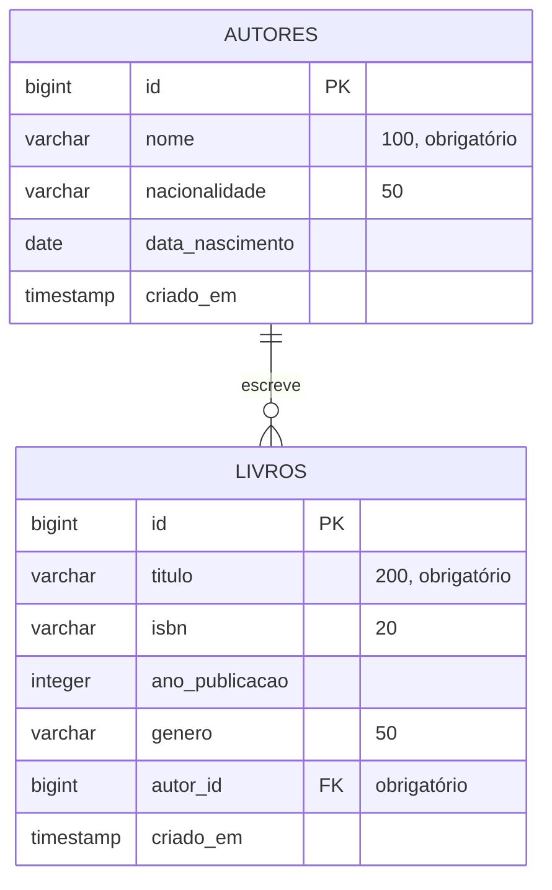

# Biblioteca Web

Sistema web de cadastro de **Autores** e **Livros**, com CRUD completo dos dois.
Cada livro é escrito por um autor e um autor pode ter vários livros: relacionamento **1 : N**
(a chave estrangeira `autor_id` fica na tabela `livros`).

Projeto da disciplina de Engenharia de Software (Parte 2 – Laboratório), feito no mesmo fluxo
da Agenda Web: branches por funcionalidade → Pull Request → Code Review → Merge → CI → Docker.

## Tecnologias

| Camada | Tecnologia |
|--------|-----------|
| Backend | Java 17 + Spring Boot 3.2 (Web, Data JPA, Validation, Lombok) |
| Frontend | React 18 + React Router 6 + Axios (react-scripts 5) |
| Banco de Dados | PostgreSQL 15 (desenvolvimento) • H2 em memória (perfil `test`) |
| Testes | JUnit 5 + Mockito (`@WebMvcTest`, `@MockBean`, MockMvc) • `@SpringBootTest` • Jest |
| Build | Maven • Node.js 20 + npm |
| Versionamento | Git + GitHub |
| CI | GitHub Actions |
| Containers | Docker + Docker Compose |
| Documentação da API | Swagger (springdoc-openapi) |

## Modelo de dados



## Estrutura do Projeto

```
biblioteca-web/
├── backend/                         # API REST (Java/Spring Boot)
│   ├── pom.xml
│   ├── Dockerfile
│   └── src/
│       ├── main/java/com/biblioteca/
│       │   ├── model/               # Autor.java, Livro.java (entidades JPA)
│       │   ├── repository/          # AutorRepository, LivroRepository
│       │   └── controller/          # AutorController, LivroController
│       ├── main/resources/application.properties
│       └── test/                    # *ControllerTest, IntegracaoTest
├── frontend/                        # UI (React)
│   ├── package.json
│   ├── Dockerfile
│   ├── nginx.conf
│   ├── public/
│   └── src/
│       ├── components/              # AutorList/Form, LivroList/Form
│       ├── services/api.js          # chamadas HTTP (Axios)
│       └── App.js                   # menu e rotas
├── docker-compose.yml               # backend + frontend + postgres
├── .github/workflows/ci-cd.yml      # pipeline do GitHub Actions
└── README.md
```

## Endpoints REST

| Verbo | URL | O que faz | Status |
|-------|-----|-----------|--------|
| POST | `/api/autores` | Cria um autor | 201 / 400 |
| GET | `/api/autores` | Lista todos (ordem: nome) | 200 |
| GET | `/api/autores/{id}` | Busca um autor | 200 / 404 |
| PUT | `/api/autores/{id}` | Atualiza um autor | 200 / 404 |
| DELETE | `/api/autores/{id}` | Remove um autor (409 se tiver livros) | 200 / 404 / 409 |
| POST | `/api/livros` | Cria um livro ligado a um autor | 201 / 400 |
| GET | `/api/livros` | Lista todos (ordem: título) | 200 |
| GET | `/api/livros/{id}` | Busca um livro | 200 / 404 |
| PUT | `/api/livros/{id}` | Atualiza um livro (inclusive o autor) | 200 / 404 |
| DELETE | `/api/livros/{id}` | Remove um livro | 200 / 404 |
| GET | `/api/livros/autor/{autorId}` | Lista os livros de um autor | 200 |

Para vincular um livro a um autor, o JSON leva só o id do autor:

```json
{ "titulo": "Dom Casmurro", "isbn": "978-8535910667", "anoPublicacao": 1899,
  "genero": "Romance", "autor": { "id": 1 } }
```

## Como Executar

### Tudo com Docker Compose

```bash
docker compose up -d --build

# Frontend: http://localhost:3000
# Backend:  http://localhost:8080/api/autores
# Swagger:  http://localhost:8080/swagger-ui.html
```

### Em modo desenvolvimento

```bash
# 1. Banco
docker compose up -d postgres

# 2. Backend (porta 8080)
cd backend
mvn spring-boot:run

# 3. Frontend (porta 3000)
cd frontend
npm install
npm start
```

### Testes de aceitação com curl

```bash
# cria um autor
curl -X POST http://localhost:8080/api/autores -H "Content-Type: application/json" \
  -d '{"nome":"Machado de Assis","nacionalidade":"Brasileira","dataNascimento":"1839-06-21"}'

# cria um livro vinculado ao autor 1
curl -X POST http://localhost:8080/api/livros -H "Content-Type: application/json" \
  -d '{"titulo":"Dom Casmurro","isbn":"978-8535910667","anoPublicacao":1899,"genero":"Romance","autor":{"id":1}}'

curl http://localhost:8080/api/livros
```

## Como Executar os Testes

```bash
# Backend: todos os testes (unitários + integração com H2)
cd backend
mvn test

# Só os unitários (JUnit 5 + Mockito)
mvn test -Dtest="*ControllerTest"

# Só o de integração (@SpringBootTest)
mvn test -Dtest="IntegracaoTest"

# Frontend (Jest)
cd frontend
npm test -- --watchAll=false
```

## CI (GitHub Actions)

O workflow `.github/workflows/ci-cd.yml` roda em todo `push` e `pull_request` na `main`:

- **test-backend:** Java 17 → testes unitários → teste de integração → `mvn verify` (JaCoCo)
- **test-frontend:** Node 20 → `npm ci` → `npm test` → `npm run build`
- **deploy (extra, só em push na main):** `docker compose build` + testes de aceitação com curl
  (o deploy na AWS não é feito: precisaria de conta e credenciais)

## Divisão de Trabalho

| Integrante | Responsabilidade | Branch |
|------------|------------------|--------|
| **DEV 1 – _(nome do aluno 1)_** | CRUD de Autores: `Autor`, `AutorRepository`, `AutorController`, `AutorControllerTest`, `AutorList`, `AutorForm`; estrutura inicial, Docker | `feature/autores` |
| **DEV 2 – _(nome do aluno 2)_** | CRUD de Livros: `Livro`, `LivroRepository`, `LivroController`, `LivroControllerTest`, `IntegracaoTest`, `LivroList`, `LivroForm`; CI e README | `feature/livros` |

Cada integrante revisou o Pull Request do outro antes do merge.
